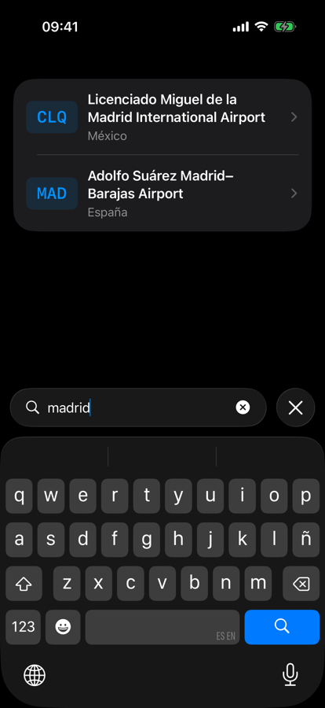
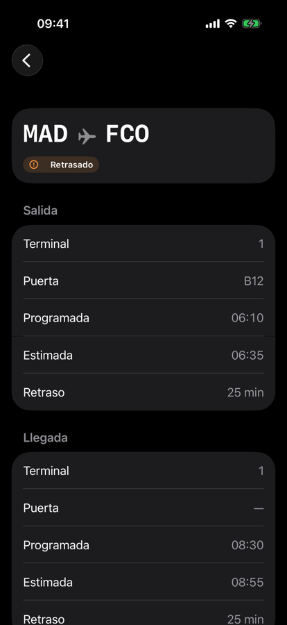
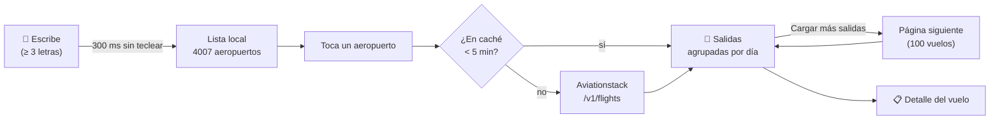
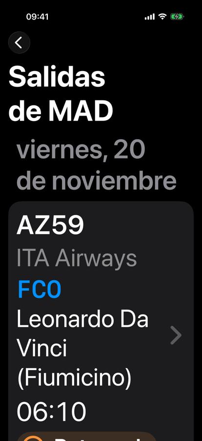
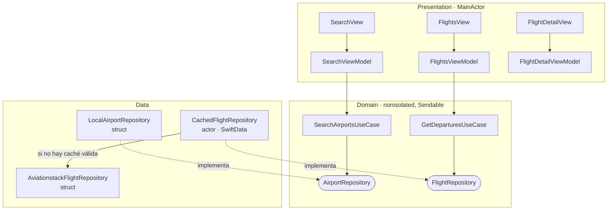
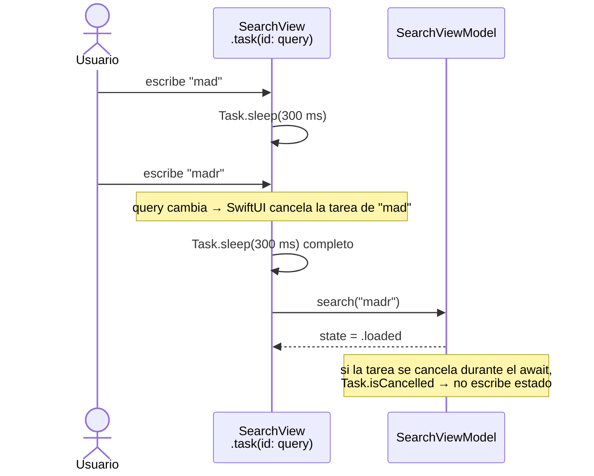

# ✈️ Aviation

[](https://github.com/aarcala10/aviation/actions/workflows/ci.yml)


App iOS en SwiftUI para buscar un aeropuerto y ver sus vuelos de salida con la API de [Aviationstack](https://aviationstack.com).

<p align="center">
  
  
  
</p>

---

## 🚀 Instalación

```bash
brew install xcodegen
xcodegen generate                                         # crea Aviation.xcodeproj desde project.yml
cp Config/Secrets.example.xcconfig Config/Secrets.xcconfig  # y pon tu clave en AVIATIONSTACK_ACCESS_KEY
open Aviation.xcodeproj                                   # ▶︎ Run
```

Tests (los mismos que pasa la CI):

```bash
xcodebuild test -scheme Aviation -destination 'platform=iOS Simulator,name=iPhone 17 Pro'
```

La clave se pasa al `Info.plist` (`AviationstackAccessKey`) y `Secrets.xcconfig` está en `.gitignore`. Sin clave la app compila y busca aeropuertos igual; solo las salidas muestran el error de la API.

### ¿Por qué XcodeGen?

- **`project.yml` es la única fuente de verdad.** Son ~60 líneas legibles que se revisan en un PR, frente a un `project.pbxproj` de miles de líneas con IDs aleatorios.
- **El `.xcodeproj` no está en git**, así que no hay conflictos de merge en el proyecto al trabajar con una rama por historia.
- **Los ajustes importantes se ven de un vistazo**: Swift 6, concurrencia estricta, `MainActor` por defecto, iOS 26 y los recursos que solo van en Debug.
- **La CI hace lo mismo que en local**: `brew install xcodegen && xcodegen generate` y después los tests.

---

## 📋 Backlog

El trabajo se organiza en historias de usuario de una línea, como [issues con la etiqueta `story`](https://github.com/aarcala10/aviation/issues?q=label%3Astory), en el [tablero del proyecto](https://github.com/users/aarcala10/projects/2). Cada historia tiene su rama, su PR y la CI en verde antes de mergear.

| # | Historia | Estado |
|---|---|---|
| [#1](https://github.com/aarcala10/aviation/issues/1) | Buscar un aeropuerto por nombre o código | ✅ |
| [#2](https://github.com/aarcala10/aviation/issues/2) | Volver a ver las salidas de un aeropuerto es instantáneo (caché) | ✅ |
| [#3](https://github.com/aarcala10/aviation/issues/3) | Ver los vuelos que salen de un aeropuerto | ✅ |
| [#4](https://github.com/aarcala10/aviation/issues/4) | Ver el detalle de un vuelo | ✅ |
| [#5](https://github.com/aarcala10/aviation/issues/5) | Cargar más vuelos con un botón (paginación) | ✅ |

Los planes que se han llevado a cabo, uno por historia (criterios de aceptación, fuera de alcance y lista de tests), están en [`docs/plans/`](docs/plans): [plan1](docs/plans/plan1.md), [plan2](docs/plans/plan2.md), [plan3](docs/plans/plan3.md), [plan4](docs/plans/plan4.md) y [plan5](docs/plans/plan5.md).

---

## 🧭 Cómo funciona



| 1. Busca | 2. Elige el aeropuerto | 3. Abre un vuelo |
|---|---|---|
|  |  |  |
| Por nombre, ciudad o código IATA, sin distinguir mayúsculas ni acentos. Salen primero el código exacto y la ciudad exacta (máximo 50 resultados). | Salidas agrupadas por día, el más reciente primero. El botón «Cargar más salidas» pide la página siguiente. | Ruta, estado y las secciones Salida, Llegada y Vuelo (terminal, puerta, horas y retraso). |

- **Búsqueda sin red:** lee `Aviation/Data/Airports/airports.json`, incluido en la app. Se generó a partir de [OurAirports](https://ourairports.com/data/) (dominio público) con estos filtros: `iata_code` no vacío, `type` en `large_airport`, `medium_airport` o `small_airport`, y `scheduled_service = yes`. Es un JSON compacto `{n, c, i, k}` (nombre, ciudad, IATA y país ISO). El país se muestra en español con `Locale`. Los nombres de ciudad se tradujeron a español ("Lisboa", "Londres", "Roma") y los resultados salen ordenados: código exacto, ciudad exacta y el resto.
- **Salidas:** `GET https://api.aviationstack.com/v1/flights?dep_iata=XXX&limit=100&offset=N`.
- **Hora local tal cual:** la API manda la hora local del aeropuerto con un falso `+00:00`, así que se muestra `HH:mm` sin convertirla. Las fechas se formatean en UTC por el mismo motivo.
- **Sin duplicados:** los vuelos con `flight.codeshared` (código compartido) se ocultan para no repetir el vuelo operado.
- **Caché de 5 minutos** que sobrevive a cerrar la app (ver [Decisiones técnicas](#-decisiones-técnicas)).

---

## ♿ Accesible

La accesibilidad es parte del "hecho" de cada historia, no un extra.

<table>
<tr>
<td width="260"></td>
<td>

- **VoiceOver:** cada fila es un único elemento con una etiqueta en orden natural («Adolfo Suárez Madrid-Barajas, M A D, España»).
- **Códigos deletreados:** IATA y números de vuelo con `speechSpellsOutCharacters()`, así que VoiceOver dice «M A D» y no «mad».
- **Destino hablado con la ciudad** («Salidas de Madrid», «a Barcelona») cuando se conoce.
- **Foco gestionado:** el título recibe el foco al entrar y al volver del detalle; tras un reintento el foco va al primer vuelo; al cargar más páginas el foco no se mueve.
- **Anuncios** de resultados y errores, con prioridad alta para que el cambio de pantalla no los corte.
- **Dynamic Type hasta AX5** (en la captura): las filas pasan de `HStack` a `VStack` y la píldora de estado no se corta.
- **El estado nunca va solo por color:** color + SF Symbol + texto, con contraste ≥ 4.5:1 en modo claro y oscuro.
- Zonas táctiles de al menos 44 × 44 pt y sin animaciones propias (Reduce Motion).

</td>
</tr>
</table>

---

## 🧱 Decisiones técnicas



Un solo target con tres capas (Data / Domain / Presentation) y, dentro de cada una, una carpeta por funcionalidad (`Airports`, `Flights`, `Search`, `Shared`). Los tests siguen la misma estructura.

### Pensada para concurrencia estricta y `MainActor` por defecto

```yaml
SWIFT_VERSION: "6.0"
SWIFT_STRICT_CONCURRENCY: complete
SWIFT_DEFAULT_ACTOR_ISOLATION: MainActor
SWIFT_APPROACHABLE_CONCURRENCY: YES
```

- **`MainActor` por defecto:** todo tipo vive en el hilo principal salvo que se marque `nonisolated`. Las vistas y los ViewModels no necesitan anotaciones; los casos de uso y los repositorios son `nonisolated` y `Sendable`.
- **Approachable Concurrency** (`NonisolatedNonsendingByDefault`, SE-0461): una función `async` nonisolated se ejecuta en el actor de quien la llama en lugar de saltar a otro hilo. Es el comportamiento por defecto de los proyectos nuevos de Xcode 26 y evita saltos y errores de `Sendable` innecesarios.
- **`@concurrent` para el trabajo de CPU:** con lo anterior, solo sale del hilo principal lo que se pide de forma explícita. Filtrar ~4000 aeropuertos (`LocalAirportRepository`) y decodificar el JSON de vuelos (`AviationstackFlightRepository`) van marcados `@concurrent`. El resto (casos de uso, ViewModels) se queda en el hilo principal porque solo esperan.

El compilador comprueba todo esto en modo estricto: no puede haber carreras de datos.

### Repositorios sin `actor`: no tienen estado mutable

`LocalAirportRepository` y `AviationstackFlightRepository` son `nonisolated struct: Sendable` y solo tienen propiedades `let`. No hay nada que proteger: un `actor` añadiría serialización (dos búsquedas no podrían ir en paralelo) y saltos de ejecutor sin ningún beneficio.

El contraste es `CachedFlightRepository`, que **sí** es `actor` porque su `ModelContext` de SwiftData es estado mutable que no puede compartirse entre hilos.

No usa la macro `@ModelActor`: conforma `ModelActor` a mano (las propiedades `modelContainer` y `modelExecutor` y su `init`, lo mismo que genera la macro). La macro solo genera `init(modelContainer:)`, que no da valor a las otras dos propiedades del actor (el repositorio real y el reloj, inyectado para que los tests controlen el tiempo), y no compila aunque se añada un `init` propio. La alternativa era separar un `@ModelActor` que solo leyera y guardara de un repositorio normal que decidiera con el TTL; se descartó porque añade un tipo para ahorrar tres líneas.

### Caché de salidas (SwiftData)

- Una entrada por petición, con clave `IATA-limit-offset`, válida **5 minutos** (con 5 minutos exactos ya cuenta como caducada).
- Sobrevive a cerrar la app. Los errores no se guardan y una entrada ilegible se ignora y se pide a la red.
- Si el almacén no se puede abrir, `AviationApp` usa el repositorio real sin caché: la app funciona igual.

### Aeropuertos en un JSON local

El plan gratuito de Aviationstack no permite `/airports`. La lista local hace además que la búsqueda sea instantánea, funcione sin red y no gaste cuota. Un texto de menos de 3 caracteres no busca (`SearchAirportsUseCase.minimumLength`).

### Red testeable sin mocks de `URLSession`

`AviationstackFlightRepository` recibe un `transport: (URLRequest) async throws -> Data`. En producción es `URLSession`; en los tests, un closure que devuelve un fixture. No hace falta `URLProtocol`.

La decodificación es **tolerante**: un vuelo ilegible se descarta sin perder el resto de la página. Las respuestas de error de la API se convierten en `APIError` y el ViewModel las traduce («Se ha agotado la cuota de la API», «La clave de la API no es válida», «Comprueba tu conexión»).

### Paginación

Páginas de 100 vuelos que se piden solo al pulsar «Cargar más salidas»: con el orden de la API una carga automática se encadenaba y gastaba la cuota. Si una página trae menos, era la última. Si una página solo trae códigos compartidos o vuelos repetidos, se pide la siguiente para que la lista siempre crezca.

> **Ojo: la API gratuita no pagina en orden.** `/v1/flights` devuelve las entradas en un orden interno, no por hora de salida: una página de MAD traía 15:00, 10:30, 12:20, 10:25… y después 17:05 → 16:20. Por eso una página nueva trae vuelos anteriores *y* posteriores, y como la lista ordena por hora dentro de cada día, algunos aparecen por encima de los que ya se veían. En el plan gratuito no hay forma de evitarlo: no existe parámetro de orden, `flight_date` y `dep_scheduled_time_dep` devuelven `function_access_restricted`, y `/v1/timetable` (que sí viene ordenado) solo admite 1 petición por minuto.

### UI tests sin red ni cuota

Con `-uiTestFixtures` la app sirve `AviationTests/Fixtures/flights.json` en vez de llamar a la API (y `-uiTestPagedFixtures` sirve dos páginas para la paginación). Los fixtures solo se copian en Debug (`EXCLUDED_SOURCE_FILE_NAMES[config=Release]`).

### Diseño nativo y sin dependencias

`List`, `NavigationStack`, `.searchable`, `ContentUnavailableView`, `LabeledContent`, SF Pro y SF Symbols. Sin fuentes personalizadas (romperían Dynamic Type) ni paquetes de terceros. El color se define con tokens en `Assets.xcassets` con variante clara y oscura.

---

## ⏹️ Cancelación con `Task`

Una respuesta que llega tarde nunca debe pisar una más nueva. La app lo consigue con la concurrencia estructurada de SwiftUI más una comprobación después de cada `await`.



**Búsqueda** (`SearchView` + `SearchViewModel`)
- `.task(id: query)`: cada cambio del texto cancela la tarea anterior y arranca otra.
- `Task.sleep(for: .milliseconds(300))` hace de *debounce*: si el usuario sigue escribiendo, la tarea se cancela antes de buscar.
- Después del `await`, el ViewModel comprueba `Task.isCancelled` y, si la tarea se canceló, no toca el estado. Nunca se ven los resultados de una búsqueda antigua.

**Salidas** (`FlightsView` + `FlightsViewModel`)
- `.task(id: attempt)`: «Reintentar» incrementa `attempt` y SwiftUI cancela la carga anterior.
- Un contador `generation` marca cada carga. Con `isCurrent(_:)`, una carga **reemplazada** no toca el estado, y una carga **cancelada** sin otra más nueva vuelve a `.idle` en lugar de dejar el spinner para siempre.
- `loadedAttempt` evita recargar al volver del detalle, porque la `.task` se reinicia cuando la vista reaparece.

**Cargar más**
- El botón «Cargar más salidas» (y «Reintentar» si falla) incrementa `moreRequest` y una `.task(id: moreRequest)` llama a `loadMore()`. Es una tarea **estructurada**: SwiftUI la cancela al salir de la pantalla. `handledMoreRequest` evita repetir la carga cuando la `.task` se reinicia al volver del detalle.
- `loadMore()` comprueba `Task.isCancelled` tras cada `await`: si se cancela, deja `more = .available` y no pide más páginas ni muestra error.
- Si mientras tanto empieza un `load()` nuevo (un reintento), `generation` cambia y la página que llega tarde se descarta.

---

## ✅ Tests y CI

- **Swift Testing**, organizado por capa y escrito antes del código (TDD) en cada historia:
  - **Domain:** casos de uso con repositorios mock.
  - **Data:** decodificación, caché (uso, expiración, entrada ilegible, almacén que no abre) y búsqueda local.
  - **Presentation:** estados de los ViewModels, incluida la cancelación.
- **XCUITest** solo para el camino feliz (buscar → salidas → detalle → paginación), con fixtures.
- **GitHub Actions** (`macos-26`) ejecuta toda la suite en cada PR contra `main`. Sin CI en verde no se mergea.
